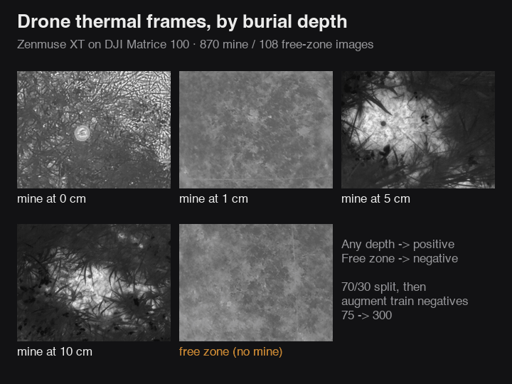
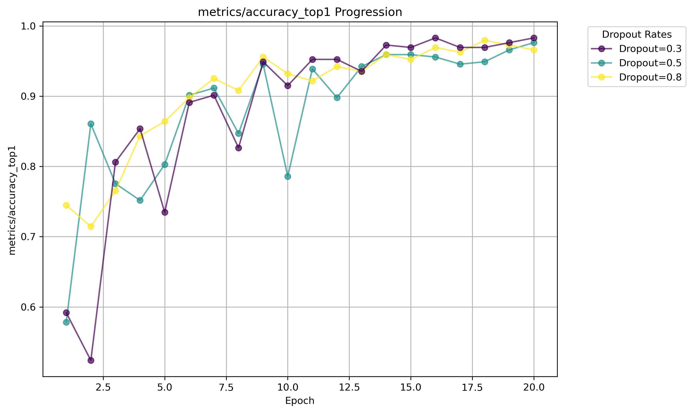

# Thermal Landmine Detection

Landmine detection from drone thermal imagery, developed at the University of Sydney. A fine-tuned YOLO11n classifier decides whether a frame shows a buried or surface mine or clear ground. It's trained on a published field dataset recorded over real test minefields at Universidad del Valle, Colombia.

  
  

*Left: predictions on a validation batch from the best run ("positive" = mine). Right: data, predictions, accuracy per epoch and confusion matrix.*

## Why I built this

Demining is still mostly done by hand, and ground robots struggle with rough
terrain and vegetation, so drone thermal imaging is a promising alternative.
The catch is that a mine's heat signature bleeds into the soil around it, which
makes it nearly invisible to the eye. I wanted to find out whether a small
pretrained CNN could still pick it out, optimising for the metric that matters
in the field: not missing mines.

Full technical report, covering architecture, training curves and results: [docs/report.pdf](docs/report.pdf).

## Run it locally

The raw dataset, the intermediate folders and the final train/val splits are all committed, so you can train straight away:

    pip install -r requirements.txt
    cd classification
    python train.py

That's a 5-epoch run at 320px with dropout 0.75. The pretrained `yolo11n-cls.pt` weights download on first run, and results go to `classification/runs/classify/`. The real experiments were 20-epoch runs on a Colab T4 (`train_experiment.py`).

To rebuild the splits from the raw data:

    cd utils && python sort_images.py        # raw -> data/sorted/{0cm,1cm,5cm,10cm,free_zone}
    # then run the last cell of classification/step_1_preprocessing.ipynb

To reproduce the held-out test result (train/val/test split, then train and score on test):

    cd preprocessing && python stratify.py    # -> data/stratified/{train,val,test}/{positive,negative}
    cd ../classification && python train_test_split.py

The scripts use paths relative to their own folder, so run each one from the directory it's in.

## How it works

    data/DatainBrief_dataset_1/<flight date>/{JPG,R_JPG}/<"Zone N Mine X cm depth">
            |  utils/sort_images.py   parse depth out of folder names
            v
    data/sorted/{0cm, 1cm, 5cm, 10cm, free_zone}
            |  step_1_preprocessing.ipynb   70/30 split, then augment train negatives
            v
    classification/{train,val}/{positive,negative}
            |  train_experiment.py   YOLO11n-cls, dropout sweep 0.3 / 0.5 / 0.8
            v
    runs/classify/trainN   ->  process_runs.py plots per-dropout curves

*Left to right: mine at 0, 1, 5 and 10 cm, then free zone.*

The images come from five drone flights (Zenmuse XT on a DJI Matrice 100, 1–10 m altitude) over nine test zones. Legbreaker-style mines are buried at 0, 1, 5 and 10 cm. Zone folders are named inconsistently (`Zone 1 Mine 1cm depth`, `Zone 5 Sruface Mine 0cm depth`, `Zone 6  free zone`), so `sort_images.py` reads the depth from the digits just before `cm`. Any depth counts as "positive" and the free zone is "negative". I used the two JPEG resolutions and skipped the TIFFs.

## The hard part

Class imbalance without leaking data. There are 870 mine images and only 108
free-zone ones, roughly 8:1. My first version of the notebook augmented the
negatives (flip, 90/180/270 rotation, brightness jitter) *before* splitting.
That meant a flipped copy of a validation image could end up in training, so
validation numbers would measure memorisation. The final version splits first
and only augments `train/negative`, taking it from 75 to 300 images. Validation
stays untouched: 261 positive and 33 negative.

The tradeoff is that validation is still imbalanced. Predicting "mine" every
time already gets 88.8%, so accuracy alone says little. The best run (dropout
0.3, `runs/classify/train1/`) reached 98.3% top-1 (289/294). The confusion matrix
shows what that's made of:

|                     | actual mine | actual free zone |
|---------------------|-------------|------------------|
| predicted mine      | 258         | 2                |
| predicted free zone | 3           | 31               |

So it missed 3 of 261 mine images and flagged 2 of 33 free-zone images as mines.

*Validation accuracy per epoch for each dropout setting.*

That 98.3% comes from the same validation set that picked the dropout and the
best epoch, so it's a little optimistic. To get a clean number I re-split the
data 70/10/20, stratified by burial depth (`preprocessing/stratify.py`), and
retrained with dropout 0.3. Then I scored the best weights once on the 196 test
images, which played no part in training or selection
(`classification/train_test_split.py`):

|                     | actual mine | actual free zone |
|---------------------|-------------|------------------|
| predicted mine      | 167         | 1                |
| predicted free zone | 7           | 21               |

**Test accuracy is 95.9% (188/196).** It missed 7 of 174 mine images and
flagged 1 of 22 free-zone images as a mine. Results are in
`classification/runs/classify/stratified_test_eval/`.

## Stack

Python, Ultralytics YOLO11, PyTorch, scikit-learn, Pillow, NumPy, pandas, matplotlib, Jupyter, Google Colab.

## Data

Tenorio Tamayo et al., *Test Images of Buried Landmines*, v4, Mendeley Data, 2023. https://doi.org/10.17632/732ngnf4r3.4

## Status

- The split is per image, not per flight, so frames from the same flight and zone can land in both train and test. A leave-one-flight-out split would be a tougher test.
- Most test errors are missed mines (7 vs 1 false alarm). For field use I'd tune the decision threshold toward recall.
- The dataset doesn't record time of day, season or ambient temperature, so there's no evidence yet that this generalises beyond these five flights.
