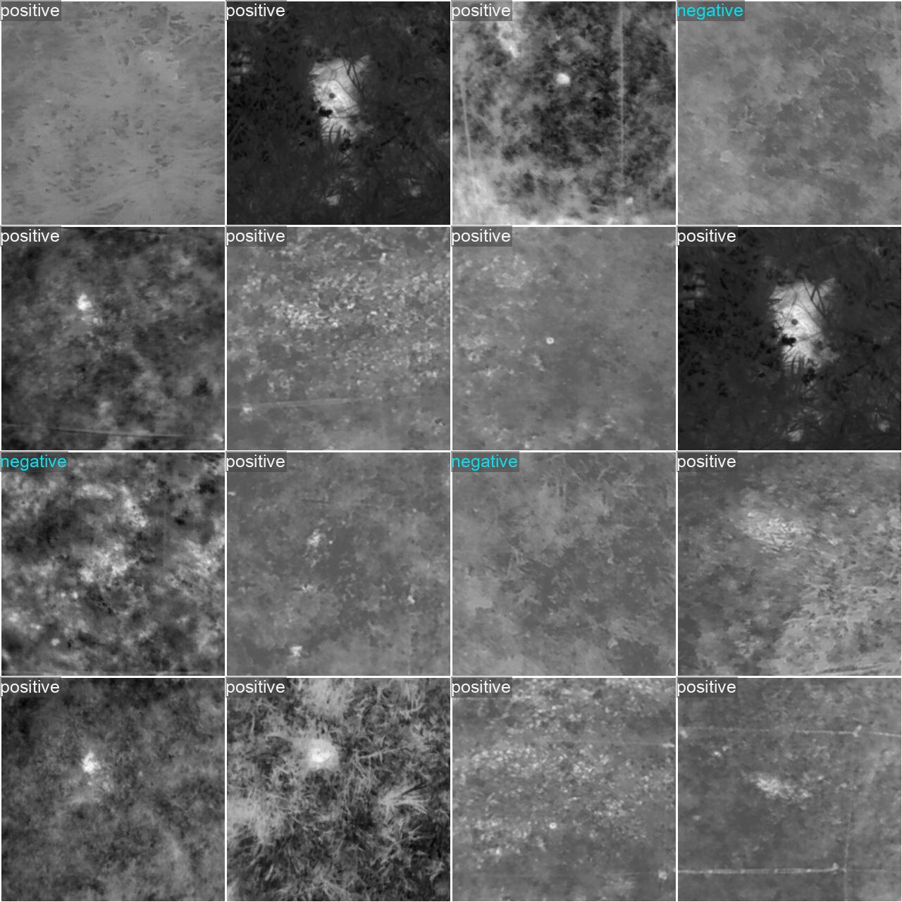
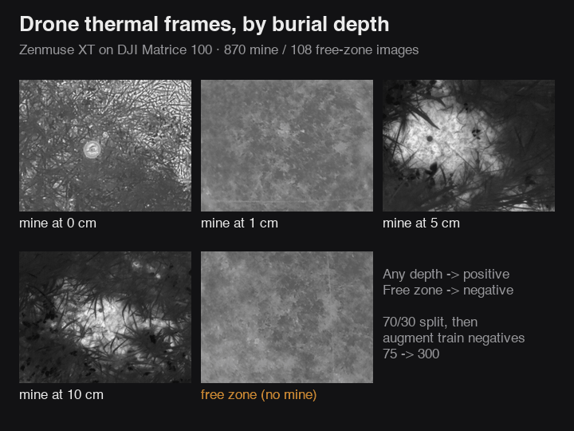
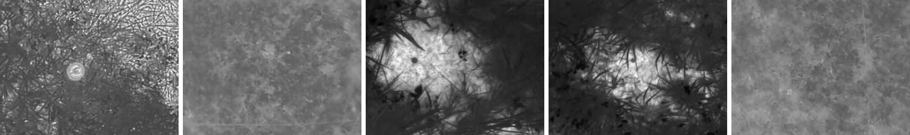
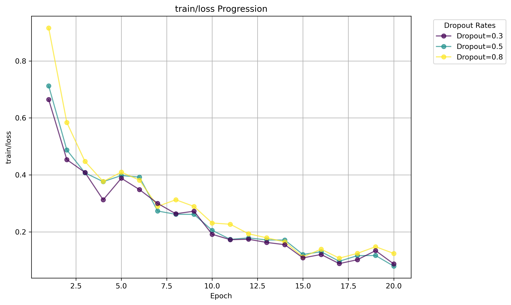
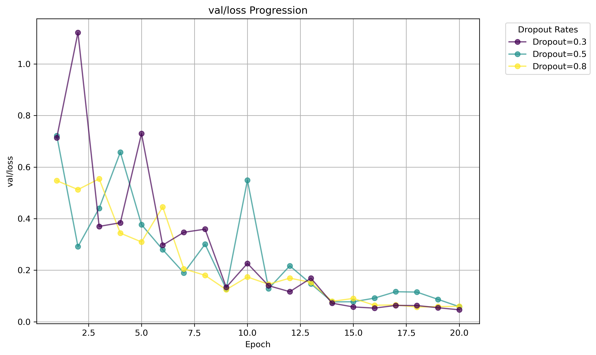
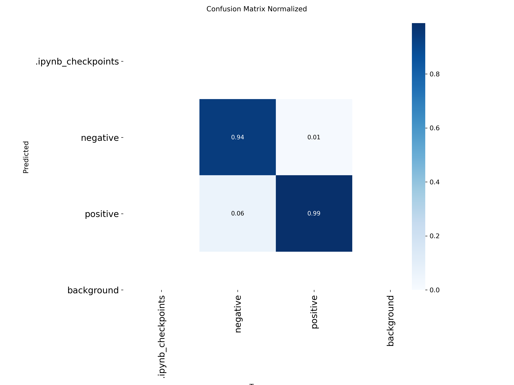

# Drone Thermal Landmine Detection

YOLO11n fine-tuned to spot landmines in drone thermal images. Trained on a public dataset of flights over real test minefields at Universidad del Valle, Colombia.

Write-up: [Landmine Detection (PDF)](docs/report.pdf),  
Research project at the University of Sydney.

  
  

95.9% on 196 held-out test images it never saw during training.
It missed 7 of the 174 mine images, and raised one false alarm.
Mines go down to 10 cm under the soil, and the drone flies mostly 1–10 m up.

## why bother

Demining is still mostly people walking fields, and ground robots get stuck in brush and rough terrain. A drone with a thermal camera doesn't have that problem. It does have a different one: a buried mine's heat signature bleeds into the soil around it, and by eye most of these frames look like nothing. I think accuracy is the wrong number to lead with here, though. What matters is how many mines it misses, so that's what I optimized for.

## run it

You need Python 3.12 (what I've tested with) and [uv](https://docs.astral.sh/uv/). The dataset and splits are committed, so there's nothing to download besides the pretrained weights, which Ultralytics fetches on first run.

    uv venv --python 3.12 && source .venv/bin/activate
    uv pip install -r requirements.txt
    cd classification && python train.py

That's a quick 5-epoch sanity run. To reproduce the test number, rebuild the split and train properly (20 epochs, about 12 minutes on an M1 CPU):

    python preprocessing/stratify.py
    python classification/train_test_split.py

`utils/sort_images.py` turns the raw flight folders into `data/sorted/`, but that's already committed, and it has to be run from inside `utils/`.

## from flight folders to yes/no

The data is Tenorio Tamayo et al., [*Test Images of Buried Landmines*](https://doi.org/10.17632/732ngnf4r3.4) (Mendeley Data, 2023): five flights with a Zenmuse XT on a DJI Matrice 100, over nine test zones at Universidad del Valle in Colombia. The zones hold legbreaker-style mines and mock objects at 0, 1, 5 and 10 cm. The zone folders are named by hand, typos included (`Zone 5 Sruface Mine 0cm depth`, `Zone 6  free zone`), so `sort_images.py` just grabs the digits before `cm` and files each image by depth. Every depth counts as "mine". I used both JPEG resolutions (720×480 and 336×256) and left the TIFFs alone.

0, 1, 5 and 10 cm, then a free zone. Good luck spotting the 1 cm one.

## 108 empty fields vs 870 mines

The free zone only has 108 images, so the classes are about 8:1. I padded the free-zone side with flips, 90/180/270° rotations and brightness jitter. My first version of the split did that *before* splitting, which put flipped copies of validation images straight into training. The version that shipped splits first and only augments `train/negative` (75 → 300).

The validation set stays lopsided (261 vs 33), and answering "mine" every time already scores 88.8%. So the 98.3% from the dropout sweep (0.3 won, `runs/classify/train1/`) is less impressive than it sounds.

  
  

Train and validation loss for the three dropout runs, 20 epochs each. The 0.3 run's validation loss spikes to 1.12 on epoch 2, when its accuracy falls to 52%, then settles.

Validation, dropout 0.3, normalized per true class: 94% of free-zone frames and 99% of mine frames come out right.

That 98.3% is also a bit optimistic, because the same set picked the dropout and the epoch. For a clean number I re-split 70/10/20 stratified by depth, retrained, and scored the test set exactly once:

|                     | actual mine | actual free zone |
|---------------------|-------------|------------------|
| predicted mine      | 167         | 1                |
| predicted free zone | 7           | 21               |

That's 188 of 196.

## built with

Python, Ultralytics YOLO11, PyTorch, scikit-learn, Pillow, pandas, matplotlib, Jupyter. The sweep ran on a Colab T4.

## dataset nuance

The dataset doesn't record time of day, season or ambient temperature. Five flights is all it's seen, therefore adding more diverse data could be the next step.
